# TravelMemory — MERN Application Deployment

TravelMemory is a MERN (MongoDB, Express, React, Node.js) application. This project outlines the deployment of the application on AWS EC2 instances, with load balancing and optional Cloudflare DNS integration.

This guide describes the process of provisioning one backend and one frontend instance end to end, creating AMIs from each, scaling each tier to two instances, placing each layer behind its own Application Load Balancer, and optionally mapping a custom domain through Cloudflare.

## Overview

| Component | Technology |
|---|---|
| Database | MongoDB Atlas |
| Backend | Node.js (`backend/`), served on port 3000 |
| Frontend | React build (`frontend/`), served by Nginx on port 80 |
| Process manager | systemd (no PM2) |
| Scaling | AMI → 2 backend + 2 frontend EC2 instances |
| Load balancing | 2 Target Groups · 2 Application Load Balancers |
| DNS (optional) | Cloudflare |

### Target Architecture

```
Browser → (Cloudflare, if used) → Frontend ALB → Frontend EC2 ×2 → Backend ALB → Backend EC2 ×2 → MongoDB Atlas
```

## Prerequisites

- An AWS account with access to EC2, AMIs, Target Groups and Load Balancers
- A MongoDB Atlas account
- A `.pem` key pair for SSH access to EC2
- (Optional) A domain name and a Cloudflare account
- Source repository: `https://github.com/UnpredictablePrashant/TravelMemory.git`

## Deployment Steps

### 1. MongoDB Atlas Setup

1. Create a free cluster at `cloud.mongodb.com`.
2. **Database Access** → Add New Database User → save the username and password.
3. **Network Access** → Add IP Address → `0.0.0.0/0` (EC2 IPs vary).
4. **Connect** → Drivers → copy the connection string:

```
mongodb+srv://<username>:<password>@cluster0.xxxxx.mongodb.net/travelmemory?retryWrites=true&w=majority
```

Keep this string; it goes into the backend `.env` in Step 3.

Below is screenshot of the MongoDB Atlas setup:
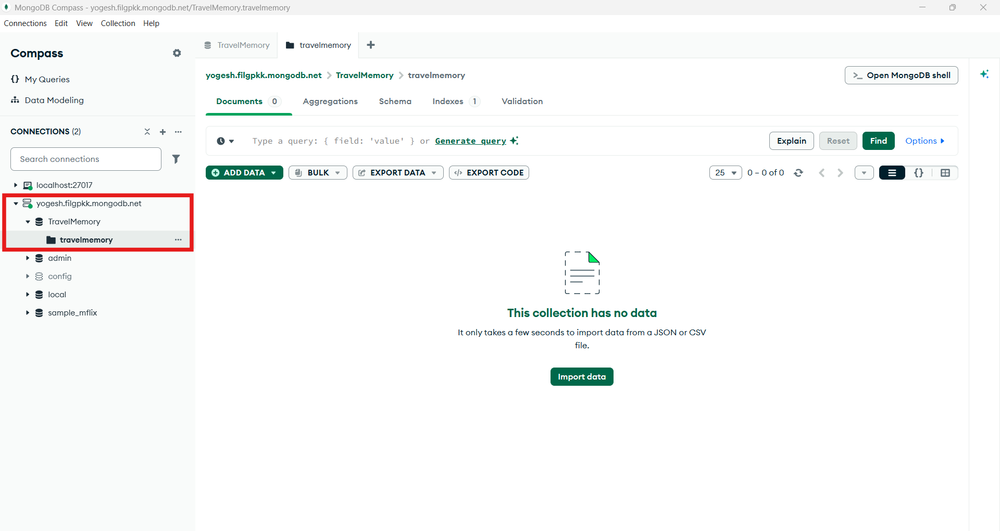

### 2. Launch the Two Master Instances

Launch two **Ubuntu 22.04** EC2 instances:

- `backend-master` — backend
- `frontend-master` — frontend

Security group ports:

| Port | Purpose |
|---|---|
| 22 | SSH |
| 80 | HTTP (Nginx) |
| 3000 | Backend (Node app, for direct testing) |

SSH into each instance:

```bash
ssh -i your-key.pem ubuntu@<public-ip>
```
Below is screenshot of the EC2 instances setup:
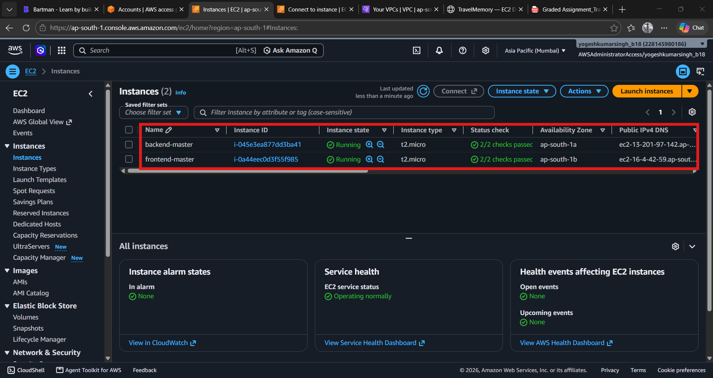
### 3. Backend Setup (on `backend-master`)

SSH into the backend instance and run:
```bash
sudo apt update
sudo apt install -y nodejs npm git nginx
git clone https://github.com/UnpredictablePrashant/TravelMemory.git
cd TravelMemory/backend
npm install
```

Create `backend/.env`:

```
MONGO_URI=mongodb+srv://<username>:<password>@cluster0.xxxxx.mongodb.net/travelmemory?retryWrites=true&w=majority
PORT=3000
```
Below is screenshot of the backend `.env` file configuration: 

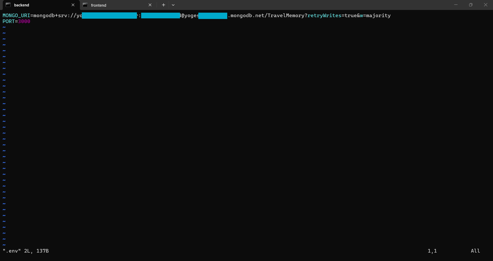

Test it: run `node index.js`, then in another terminal `curl localhost:3000/hello`. Stop with `Ctrl+C`.

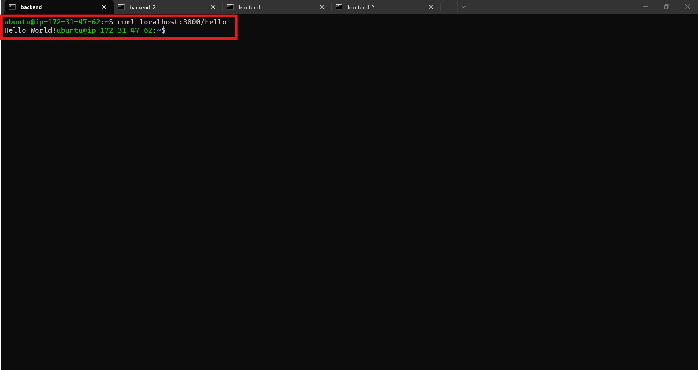


#### Run the backend as a systemd service

Create `/etc/systemd/system/travelmemory-backend.service`:

```ini
[Unit]
Description=TravelMemory Backend
After=network.target

[Service]
Type=simple
User=ubuntu
WorkingDirectory=/home/ubuntu/TravelMemory/backend
EnvironmentFile=/home/ubuntu/TravelMemory/backend/.env
ExecStart=/usr/bin/node index.js
Restart=always
RestartSec=5

[Install]
WantedBy=multi-user.target
```

Enable and start:

```bash
sudo systemctl daemon-reload
sudo systemctl enable --now travelmemory-backend
sudo systemctl status travelmemory-backend
```

> **Why systemd?** It restarts the app on crash and starts it automatically on boot. This matters because every instance launched from the AMI (Step 7) must bring up the backend on its own.

Below is screenshot of the systemd service setup:
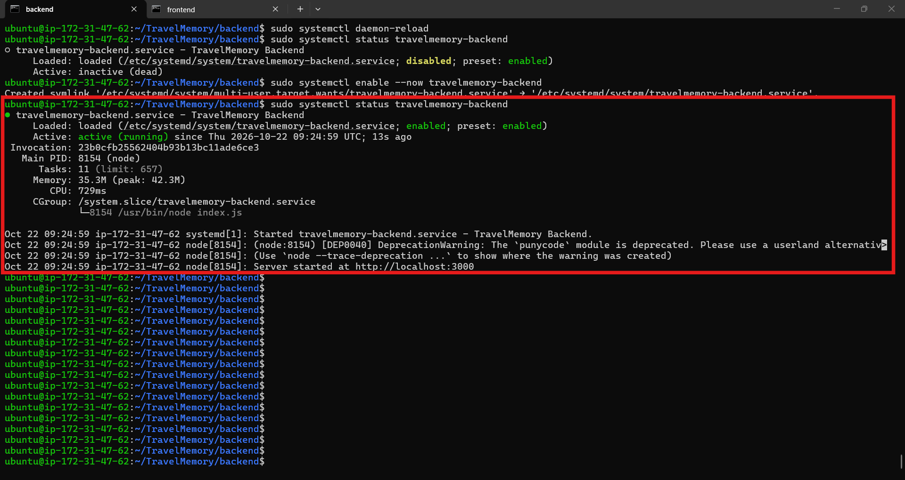
#### Nginx reverse proxy

Edit `/etc/nginx/sites-available/default` and replace the default `location /` with:

```nginx
location / {
    proxy_pass http://localhost:3000;
    proxy_set_header Host $host;
    proxy_set_header X-Real-IP $remote_addr;
    proxy_set_header X-Forwarded-For $proxy_add_x_forwarded_for;
}
```

```bash
sudo nginx -t
sudo systemctl restart nginx
```

Verify:

```bash
curl http://<backend-master-public-ip>/hello   # → Hello World!
```
Below is screenshot of the Nginx reverse proxy setup on cmd and browser:
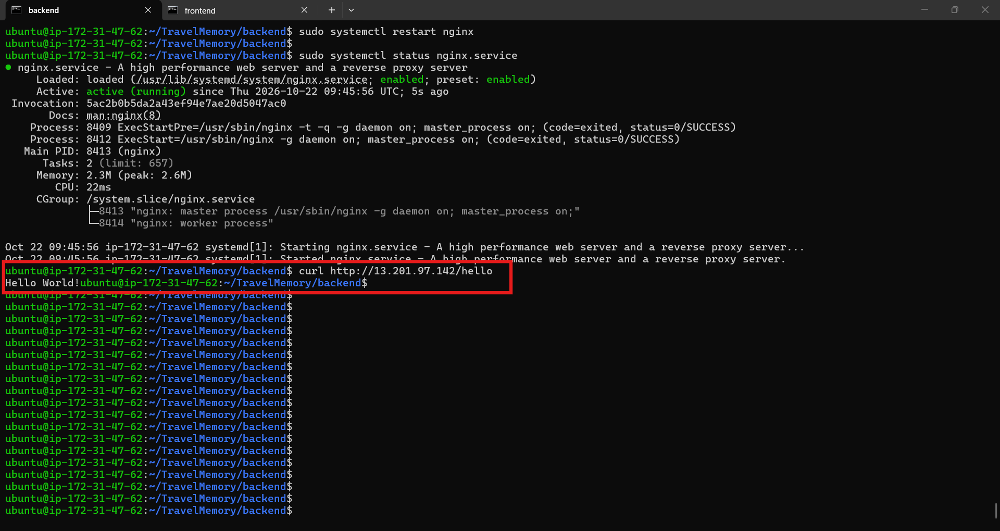

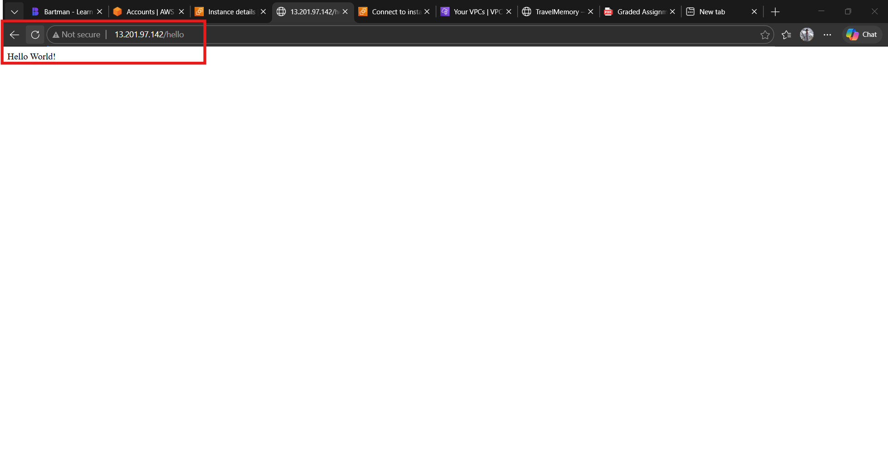

### 4. Frontend Setup (on `frontend-master`)

Go to the frontend instance and run:
```bash
sudo apt update
sudo apt install -y nodejs npm git nginx
git clone https://github.com/UnpredictablePrashant/TravelMemory.git
cd TravelMemory/frontend
```

Edit `src/url.js` (interim value; repointed in Step 10):

```js
export const baseUrl = "http://<backend-master-public-ip>";
```

Build and deploy:

```bash
npm install
npm run build
sudo rm -rf /var/www/html/*
sudo cp -r build/* /var/www/html/
sudo systemctl restart nginx
```

### 5. Verify the Baseline Before Imaging

Open `http://<frontend-master-public-ip>` in a browser. Confirm:

- Trips load. Below is screenshot of the frontend page of Trips loaded from MongoDB Atlas through the backend.

    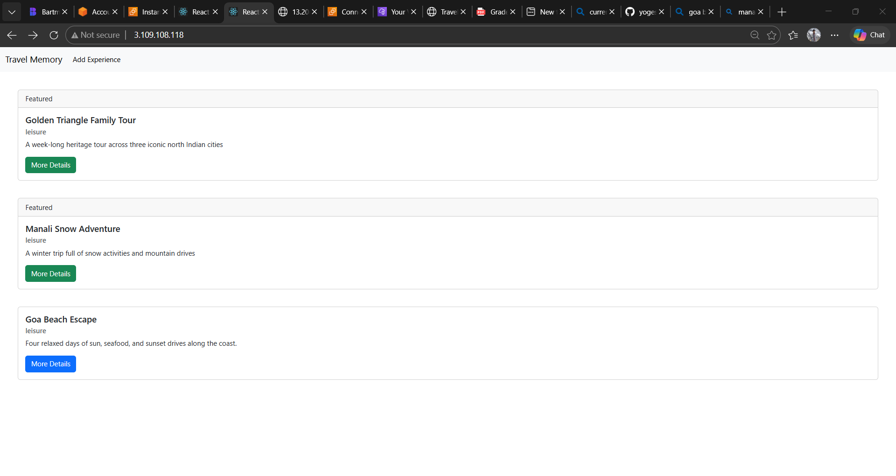
- Adding a new experience works end to end (frontend → backend → Atlas). \
Below is screenshot of the frontend page of adding new experience and the newly added experience loaded from MongoDB Atlas through the backend.

    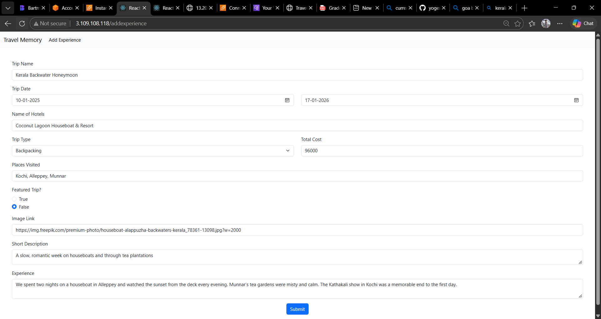

- Below is screenshot of the MongoDB Atlas page of the newly added experiences:

    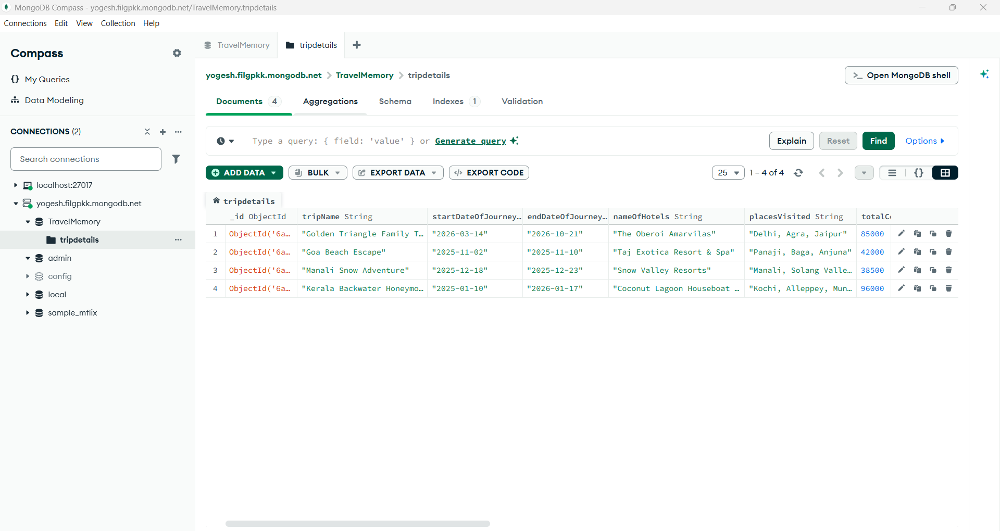

> **Do this before creating any AMI.** Anything broken here gets copied into every instance launched from the image.

### 6. Create AMIs

In the EC2 console:

1. Select `backend-master` → **Actions → Image and templates → Create image** → name `travelmemory-backend-ami`.
2. Select `frontend-master` → same path → name `travelmemory-frontend-ami`.
3. Wait until both show status **Available** on the AMIs page.
 Below is screenshot of the AMIs created from the backend and frontend instances:

    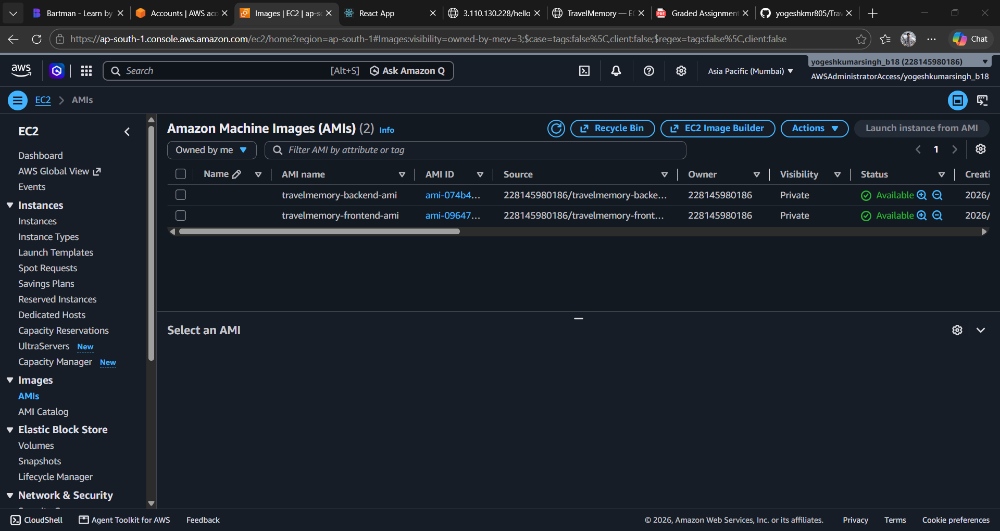

### 7. Launch Instance #2 From Each AMI

1. Launch from `travelmemory-backend-ami` → name `backend-2`.
2. Launch from `travelmemory-frontend-ami` → name `frontend-2`.

You now have 2 backend instances (`backend-master`, `backend-2`) and 2 frontend instances (`frontend-master`, `frontend-2`).

Below is screenshot of the new backend and frontend instances launched from the AMIs:

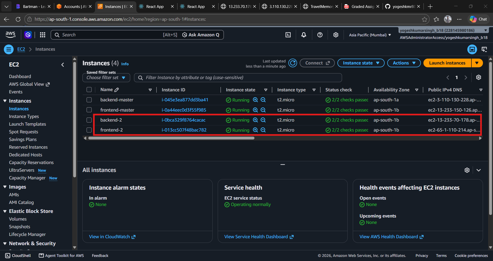

Because systemd was enabled before imaging, `backend-2` serves on port 3000 (via Nginx on 80) on boot. Confirm:

```bash
curl http://<backend-2-public-ip>/hello
```
Below is screenshot of the backend-2 instance running and the curl command output:

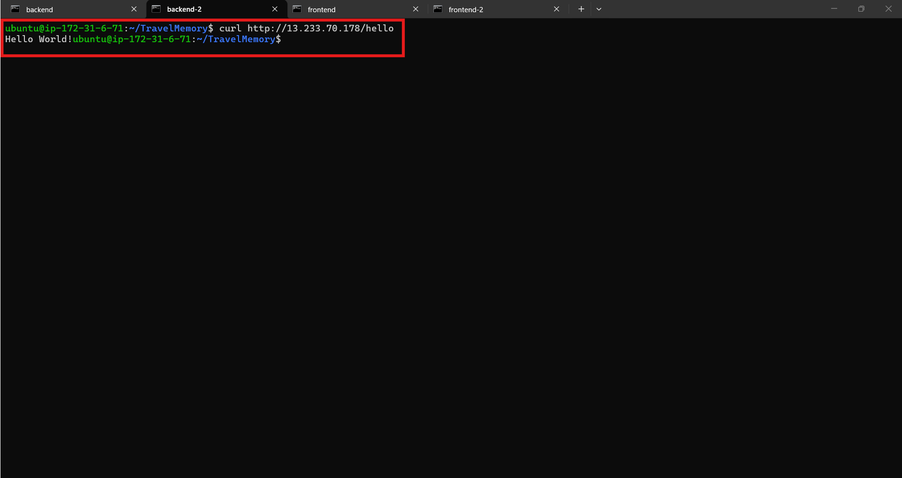

### 8. Backend Target Group + Load Balancer

**Target Groups** (EC2 console):

- Create `travelmemory-backend-tg` — HTTP, port 80, health check path `/hello`.
- Register `backend-master` and `backend-2`.

Below is screenshot of the backend target group created and the backend instances registered:

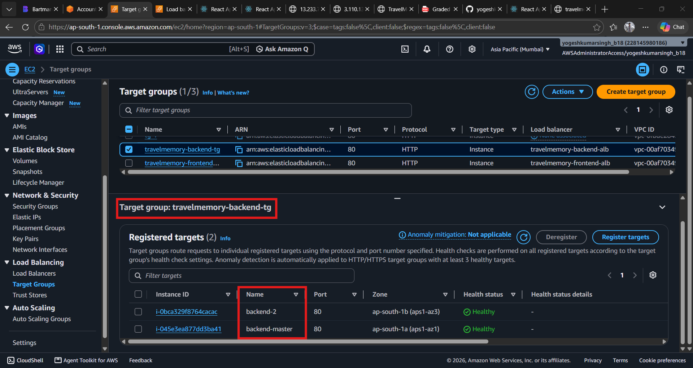

**Load Balancers**:

- Create Application Load Balancer `travelmemory-backend-alb` — internet-facing, listener on port 80 → `travelmemory-backend-tg`.
- Note its DNS name (e.g. `travelmemory-backend-alb-424715559.ap-south-1.elb.amazonaws.com`).

Below is screenshot of the backend load balancer created and the DNS name noted:

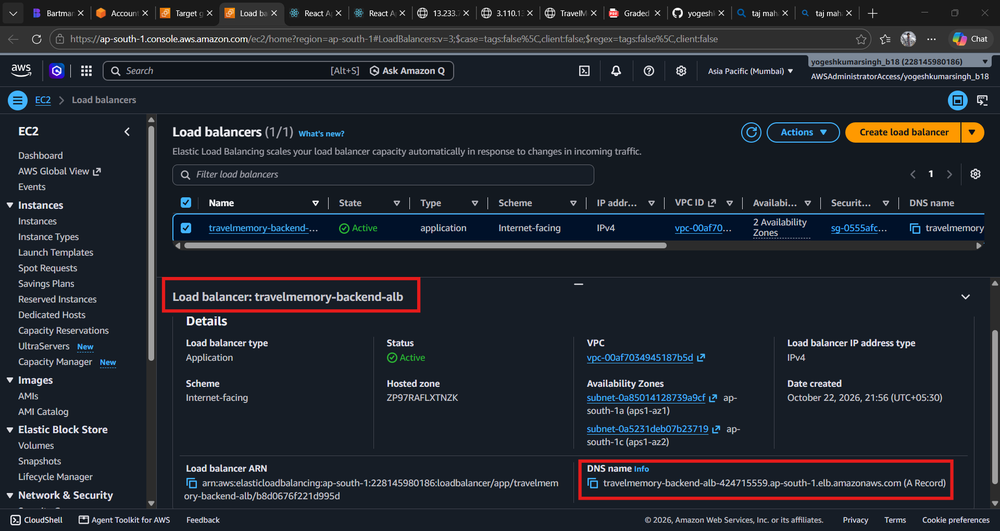

### 9. Frontend Target Group + Load Balancer

- Create target group `travelmemory-frontend-tg` — HTTP, port 80, health check path `/`.
- Register `frontend-master` and `frontend-2`.
- Create Application Load Balancer `travelmemory-frontend-alb` — internet-facing, listener on port 80 → `travelmemory-frontend-tg`.
- Note its DNS name.

Below is screenshot of the frontend target group and load balancer created and the DNS name noted:

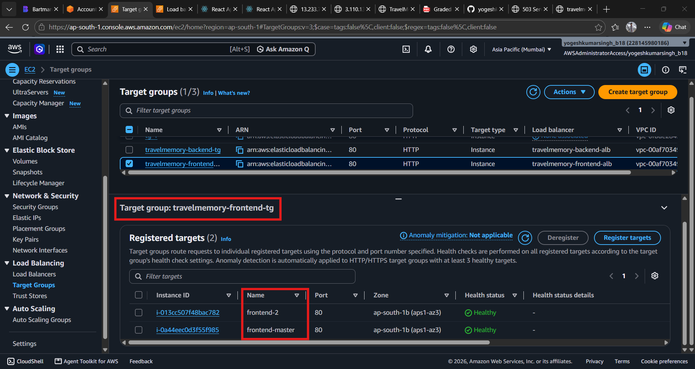

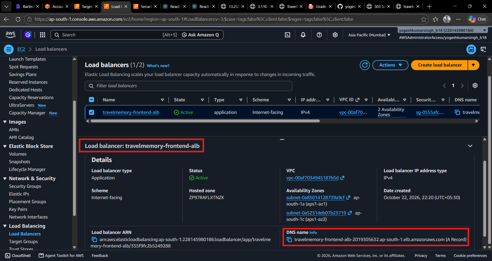

The frontend ALB DNS name alone is a valid way to test and submit if you skip DNS (Step 11).

### 10. Point Frontend at the Backend Load Balancer

On **both** `frontend-master` and `frontend-2`, edit `src/url.js`:

```js
export const baseUrl = "http://<travelmemory-backend-alb-dns>";
```

Rebuild and redeploy:

```bash
npm run build
sudo rm -rf /var/www/html/*
sudo cp -r build/* /var/www/html/
sudo systemctl restart nginx
```

> This must happen **after** imaging, on running instances. The backend ALB did not exist when the frontend AMI was created, so its address cannot be baked in ahead of time.

Below is screenshot of the frontend ALB DNS name UI and the newly added experience loaded from MongoDB Atlas through the backend ALB:

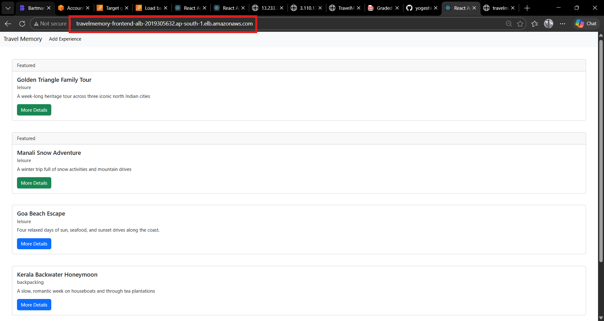

Below is the screenshot of the backend ALB DNS name UI:

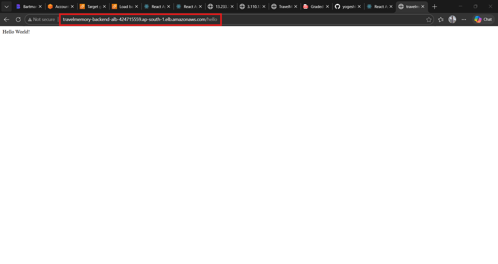

Below is screenshot of the frontend ALB DNS name and the newly added experience loaded from MongoDB Atlas through the backend ALB:

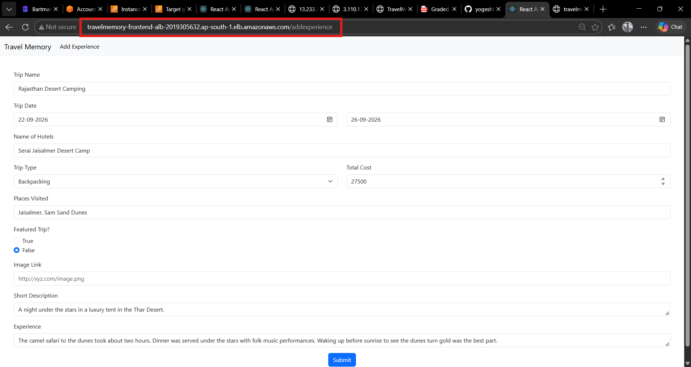

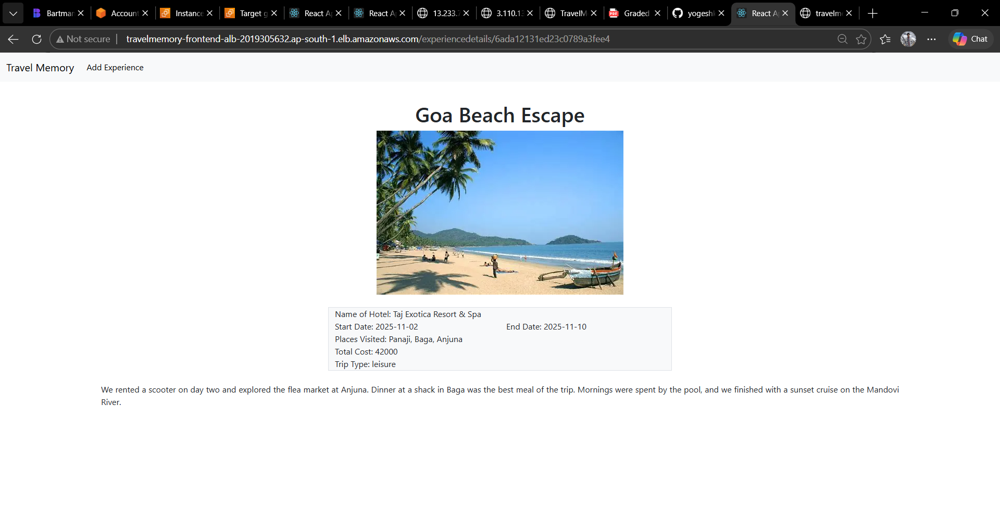

### 11. Cloudflare DNS Setup *(Optional — recommended)*

The frontend ALB DNS name already serves the app, so a custom domain is optional for basic access.

If you don't own a domain, see the [Domain purchase & configuration guide](https://docs.google.com/document/d/1rgdbvtjDcvHQsoCMGJgEAmPMtcE6AUdR8UzeYNWMQWU/edit?usp=sharing).

1. Add your domain to Cloudflare and update the registrar's nameservers to Cloudflare's.
2. In Cloudflare → DNS, add:

| Type | Name | Points to |
|---|---|---|
| CNAME | `api` | Backend load balancer DNS name |
| CNAME | `@` / `www` | Frontend load balancer DNS name |

> Both are CNAMEs because load balancer addresses are not fixed IPs. Cloudflare allows a CNAME at the root (`@`) via CNAME flattening.

Then update `src/url.js` on both frontend instances to `https://api.yourdomain.com`, rebuild, and redeploy (same commands as Step 10).

### 12. Final Verification & Deliverables

1. Visit your domain (or the frontend ALB DNS name). Trips should load from MongoDB Atlas through the backend load balancer.
2. Add a new experience from the UI and confirm it saves and appears in the list.

## Deployment Architecture Diagram
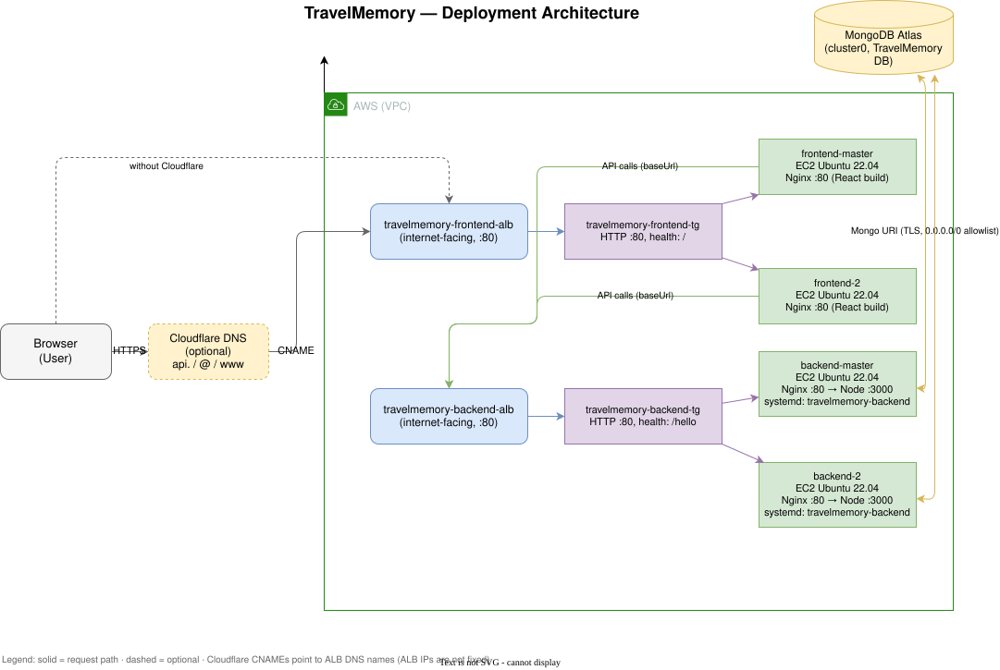

## Repository Structure

```
TravelMemory/
├── backend/
│   ├── index.js
│   ├── package.json
│   └── .env                # created in Step 3 (not committed)
└── frontend/
    ├── src/
    │   └── url.js          # backend base URL (Steps 4 and 10–11)
    ├── package.json
    └── build/              # generated by npm run build
```

## Configuration Reference

| File | Location | Purpose |
|---|---|---|
| `.env` | `backend/` | `MONGO_URI`, `PORT` |
| `travelmemory-backend.service` | `/etc/systemd/system/` | Backend process management |
| `default` | `/etc/nginx/sites-available/` | Nginx reverse proxy (backend) / static serving (frontend) |
| `url.js` | `frontend/src/` | Backend base URL |

## Troubleshooting

- **Backend not responding:** `sudo systemctl status travelmemory-backend` and `sudo journalctl -u travelmemory-backend -f`
- **Nginx config errors:** `sudo nginx -t` before restarting
- **Frontend shows stale API URL:** confirm `src/url.js` was updated and `npm run build` was re-run before copying to `/var/www/html/`
- **Target group unhealthy:** check the health check path (`/hello` for backend, `/` for frontend) and that port 80 is open in the security group
- **Cannot connect to Atlas:** confirm the Network Access allowlist includes `0.0.0.0/0` and the credentials in `.env` are correct

## Resources

- Architecture diagram tool: [draw.io](https://www.draw.io/)
- Domain setup guide: [Google Doc](https://docs.google.com/document/d/1rgdbvtjDcvHQsoCMGJgEAmPMtcE6AUdR8UzeYNWMQWU/edit?usp=sharing)